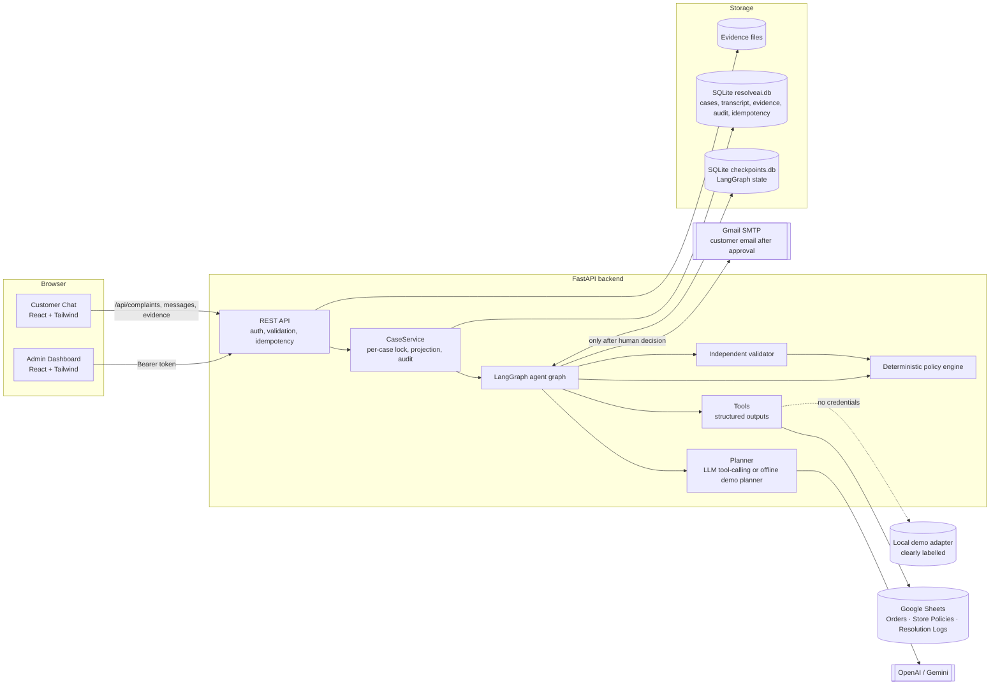

# ResolveAI — Architecture

## 1. Overview

ResolveAI is a single, stateful **LangGraph** agent behind a **FastAPI** backend, with two React interfaces
(customer chat and admin dashboard). Business data (orders, policies, resolution logs) comes from **Google Sheets**,
or from a clearly labelled **local demo adapter** with the same interface when no Google credentials are set.

## 2. Components

| Layer | File(s) | Responsibility |
|---|---|---|
| API | `app/api/routes.py` | Customer, admin and comparison endpoints; request validation; admin auth; idempotency keys; upload checks |
| Auth | `app/core/security.py` | HMAC-signed, expiring admin tokens. The LLM never sees or produces them |
| Orchestration | `app/services/case_service.py` | One LangGraph thread per case (`thread_id = case_id`); resumes interrupts; per-case lock; syncs dashboard projection and transcript |
| Agent graph | `app/graph/builder.py`, `nodes.py`, `state.py` | Stateful graph with conditional edges, three `interrupt()` checkpoints, SQLite checkpointer |
| Planner | `app/agents/planner.py`, `prompts.py` | **LLMPlanner**: OpenAI/Gemini via LangChain with structured output (analysis) and `bind_tools` (investigation). **OfflinePlanner**: deterministic stand-in, clearly labelled, used only when no key is configured |
| Tools | `app/tools/agent_tools.py` | Pydantic schemas exposed to the LLM + deterministic implementations returning structured dicts |
| Policy engine | `app/services/policy_engine.py` | All eligibility rules and money amounts. Thresholds parsed from the sheet's `policy_conditions` column (`return_window_days=7; …`) |
| Validator | `app/agents/validator.py` | Nine independent deterministic checks; recomputes eligibility from raw tool outputs |
| Data | `app/services/data_source.py` | `GoogleSheetsDataSource` (gspread, timeout, 1 retry, 30 s cache) and `LocalDemoDataSource`; both raise `DataSourceUnavailable` |
| Safety | `app/agents/safety.py` | Order-ID extraction, prompt-injection detection, untrusted-input delimiting |
| Email | `app/services/email_service.py` | Gmail SMTP sender (App Password) or clearly labelled demo outbox; idempotent per case; failures flagged and retryable |
| Baseline | `app/baseline/*` | Traditional fixed workflow and the live comparison runner |

## 3. Agent state (`AgentState`)

`case_id, conversation_history, customer_message, order_id, order_ids, identified_issues, customer_claims,
missing_information, order_information, delivery_information, retrieved_policies, return_eligibility,
refund_checks, evidence_verification, investigation_history, agent_messages, proposed_resolution,
policy_assessments, validation_result, risk_flags, approval_status, administrator_decision,
draft_customer_response, final_response, status, system_error` (+ control fields).

Every node's output is checkpointed to `checkpoints.db`, so a case survives a backend restart
(verified by test `e2e06`).

## 4. Tools

| Tool | Offered to LLM | Output (structured) |
|---|---|---|
| `lookup_order(order_id)` | yes | `{found, order{…}}` |
| `get_delivery_status(order_id)` | yes | delivery days, late/overdue/lost flags, tracking |
| `retrieve_store_policies(issue_category, query?)` | yes | active policies for the category, keyword-ranked |
| `verify_return_eligibility(order_id)` | yes | eligible, days since delivery, hygiene check, reasons |
| `verify_damage_evidence(case_id)` | yes (case_id forced to current case) | photo count, file-integrity results |
| `check_previous_refund(order_id)` | yes | previous refund status, duplicate flag |
| `request_customer_information(question, missing)` | yes (control) | pauses the graph and asks the customer |
| `submit_resolution_proposal(items, summary)` | yes (control) | hands a proposal to validation (no amounts — engine computes them) |
| `save_resolution_log(case_data)` | **no** — system only | written by the graph's logging node |
| `gmail_send` (send_customer_email node) | **no** — system only, after the human decision | email to the customer; status sent / recorded / failed |

**External services used:** Google Sheets (orders, policies, logs), Gmail (customer email), and an LLM API (Gemini/OpenAI).

**Permission boundary** (in the tool executor): the model may only query order IDs the customer supplied in this
case; `verify_damage_evidence` always uses the current case; unknown tools and malformed arguments are rejected
with an error message the model can read.

## 5. Safety design

1. Customer text is untrusted: scanned for injection patterns (→ `prompt_injection_attempt` risk flag) and always
   given to the LLM inside `<customer_message>` tags declared as data.
2. The LLM has **no approval tool and no write tool** for policies or payments.
3. Amounts and eligibility come only from the deterministic policy engine.
4. The validator independently recomputes everything; failures go back for revision, to the customer, or to the
   admin marked `validation_failed_escalated`.
5. Every proposal stops at a human-approval `interrupt()`. The only irreversible action, emailing the customer, is a graph node that runs *after* that decision; the LLM cannot reach it. It sends at most one email per case. There is no payment code.
6. Admin endpoints require a signed token; decisions use idempotency keys plus a state check (second approve → 409).
7. Uploads: type from magic bytes (JPEG/PNG/WEBP), 5 MB cap, SHA-256 stored and re-checked.
8. Secrets live in `backend/.env` (git-ignored); `/api/health` exposes only non-secret labels.
9. Data-source/LLM failures route to a `system_recovery` interrupt; nothing is invented.
10. Customer view is sanitised: no risk flags, validation details or internal notes.

## 6. Two modes, clearly labelled

| | Planner | Data | Email |
|---|---|---|---|
| Full | OpenAI or Gemini (`LLM_PROVIDER`) | Google Sheets | Gmail |
| Demo | `OFFLINE DEMO PLANNER` | `LOCAL DEMO DATA (not Google Sheets)` | `DEMO OUTBOX (not sent)` |

The active mode is shown in a banner on both interfaces and stored in every investigation step (`planner` field).
