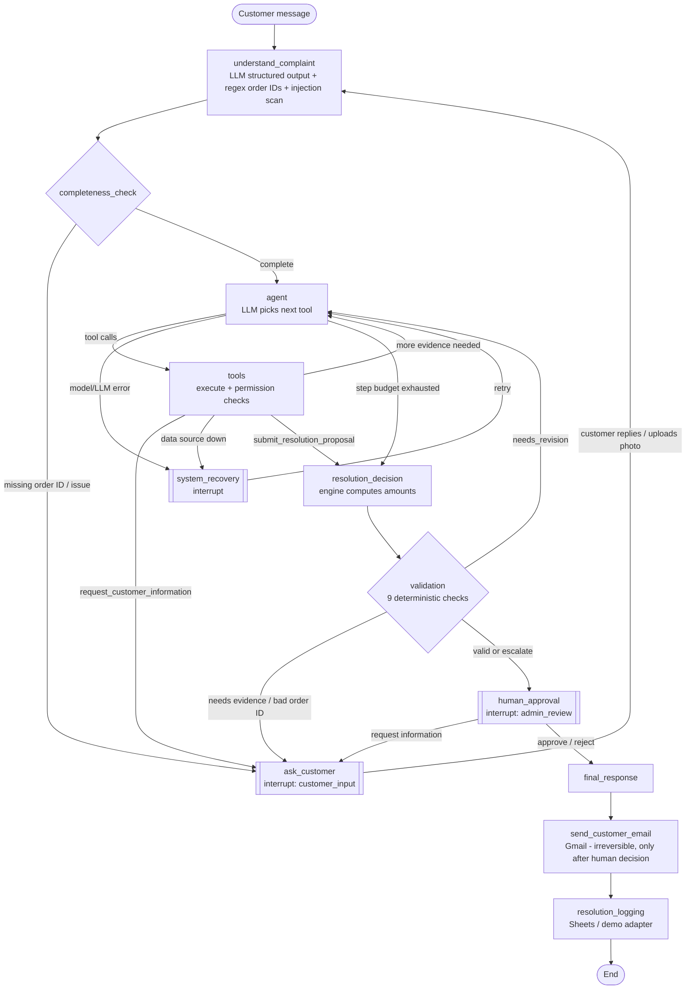

# ResolveAI — Agent Workflow

## LangGraph graph (as implemented in `app/graph/builder.py`)

Double-bordered nodes pause the graph with `interrupt()`. The state is checkpointed in SQLite and the same
thread resumes with `Command(resume=…)` when the customer replies, uploads a photo, the admin decides, or a retry is requested.

## Why this is agentic and not a fixed script

* The **agent node** is an LLM call with eight tools bound. It sees a freshly built *case brief* (issues, orders,
  claims, evidence count, risk flags, conversation) plus all previous tool calls and results, and chooses the next call.
  The graph does not hard-code which tool comes next.
* Different complaints lead to different tool sequences (tested: delivery tools only appear for delivery issues).
* Results change the plan: an order that is not found → ask the customer; an already-refunded order → skip the photo request
  and propose denial; missing photo → pause and resume later.
* The validator's feedback goes back to the agent as a message, so it can fix its own proposal.

## Validation checks

| Check | Fails when |
|---|---|
| order_exists | a referenced order was not found / not looked up |
| all_issues_addressed | an identified issue has no action, or an action addresses an issue the customer never raised |
| order_supports_complaint | e.g. damage claim on an order that was never delivered |
| policies_retrieved | the agent did not retrieve the policy category an issue needs |
| required_investigation_done | e.g. return decision without `verify_return_eligibility`; money outcome without `check_previous_refund` |
| policy_consistent | the proposed action is not in the engine's allowed set |
| required_evidence_present | e.g. damage refund without a verified photo |
| no_duplicate_refund | a second refund proposed for an already-refunded order |
| no_unsupported_assumptions | foreign order IDs, unretrieved policy IDs, amounts above the policy amount |
| admin_approval_required | always true (P005) — informational |

Outcome routing: `valid` → human approval · `needs_revision` → agent (max 2 revisions) · `needs_evidence` /
`needs_customer_info` → ask customer · still failing after revisions → `escalate` (human approval with failures shown).

## Case status lifecycle

`received → investigating → awaiting_customer ⇄ investigating → pending_approval → approved | rejected`
with side states `info_requested` (admin asked a question) and `awaiting_system_recovery`.
